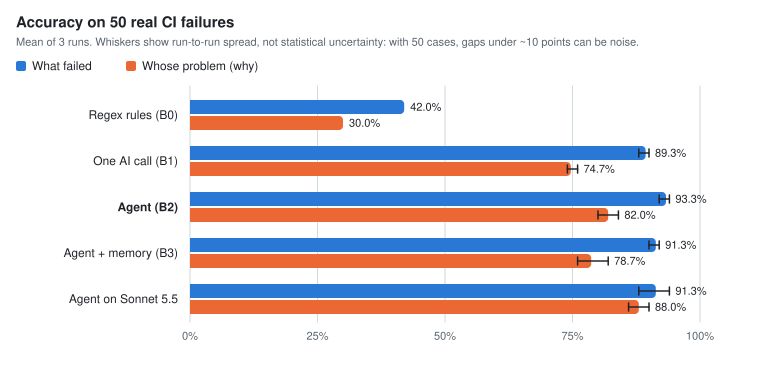
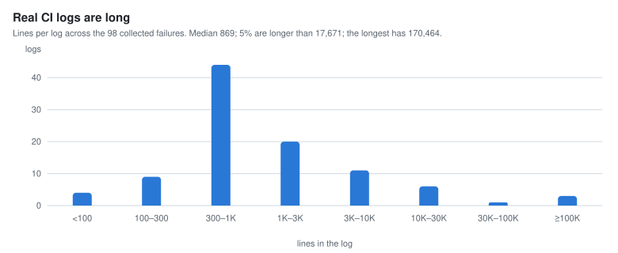
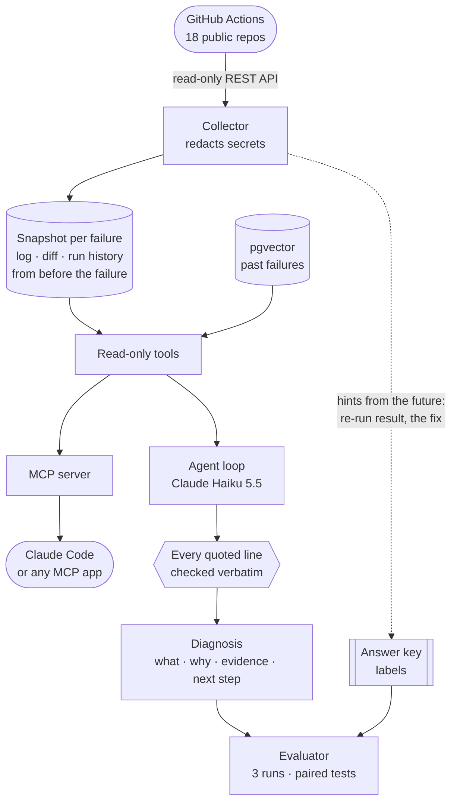
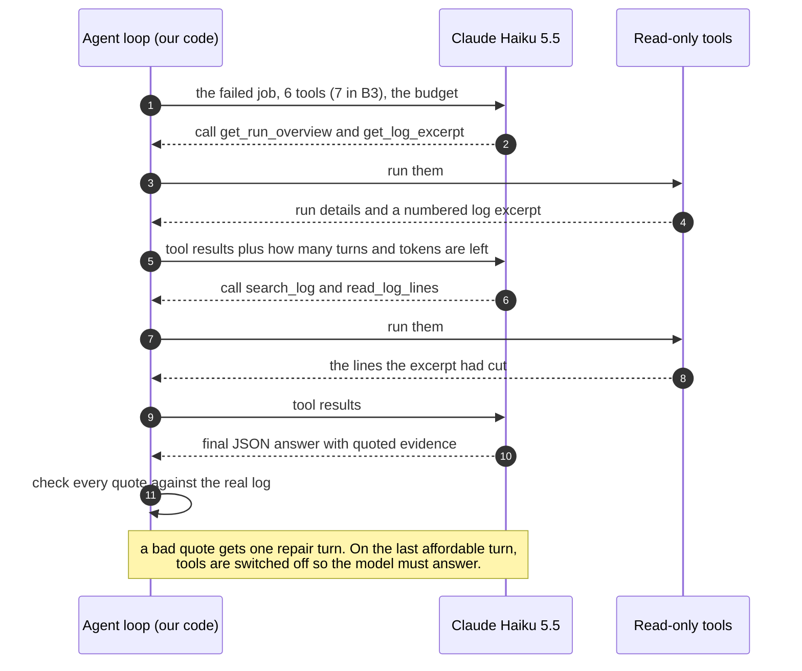
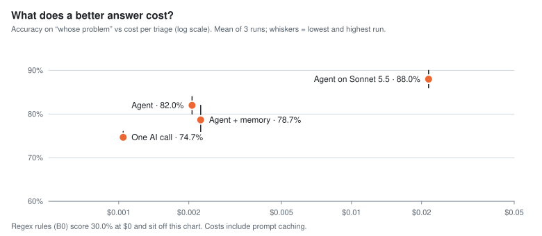
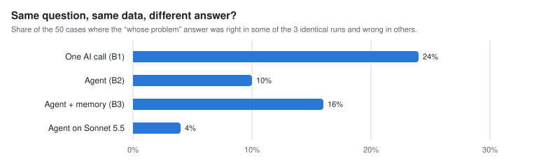
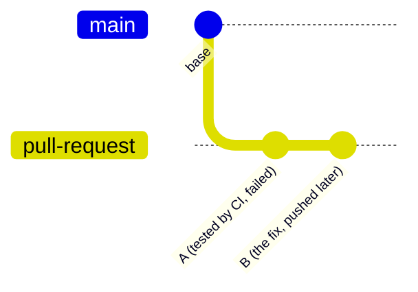

<div align="center">

# TriageBench

**An LLM agent that diagnoses failing CI runs, and the evaluation harness that tests whether it's worth it**

[](https://github.com/ahrazkk/TriageBench/actions/workflows/ci.yml)


</div>

Every time code is pushed to GitHub, **continuous integration (CI)** builds it and runs the tests
automatically. When a CI job fails, somebody has to read its log (thousands of lines is normal;
the longest here is 170,464) and answer two questions: **what broke**, and **whose problem is
it**? The change under test, a test that fails at random, something outside the repository, a
broken test, or a CI mistake?

TriageBench is an LLM agent that answers both questions and backs its answer with **quoted log
lines, each checked word for word against the real log**. Around it is an evaluation harness that
asks whether the agent is worth its cost: 98 real failures from 18 well-known open-source projects
(50 graded, 48 kept as the agent's memory of past failures), four competing systems from regex
rules up to an agent with memory, three runs of each AI system, and statistics that separate real
improvements from luck.

<table>
<tr>
<td align="center"><b>98</b><br><sub>real CI failures from 18 open-source repos</sub></td>
<td align="center"><b>93% · 82%</b><br><sub>agent accuracy, what failed · whose problem<br>(vs 42% · 30% for regex rules; preliminary)</sub></td>
<td align="center"><b>0</b><br><sub>made-up evidence quotes<br>(every quote verified)</sub></td>
<td align="center"><b>$0.002</b><br><sub>per triage on Claude Haiku 5.5</sub></td>
</tr>
</table>

<p align="center">
<picture>
  <source media="(prefers-color-scheme: dark)" srcset="docs/img/accuracy-dark.svg">
  
</picture>
</p>

**What I found**

- **One LLM call does most of the work.** It beats hand-written rules by 47 points on "what
  failed" and 45 on "whose problem".
- **The agent is best, but its extra gain isn't proven yet:** +7 points on "whose problem" over
  one call, p = 0.21 on 50 cases. It wins exactly where the deciding log line was cut from the
  excerpt and it had to go and find it.
- **A 20×-per-token model (Sonnet 5.5) adds 6 points (p = 0.07)** at about 10× the cost per
  triage, and is far more consistent between runs.
- **One run can lie:** a single run made memory look significantly harmful; three runs showed it
  wasn't.
- **I caught a leak in my own data:** saved diffs for some pull requests included commits made
  *after* the failure. Fixed, tested and re-measured: it had inflated the agent's score by 2 points.

> [!IMPORTANT]
> **The answer key is AI-drafted and not yet human-reviewed**, by the same model family that is
> being graded, with access to hindsight hints. What was done about it so far: an independent
> blind re-judging of the 14 cases where two models disagreed (2 drafts flagged as likely wrong)
> and a sensitivity check (fixing those 2 would move scores by up to 2 points). Treat every
> accuracy number as preliminary until the review is done.

---

**Contents:** [The problem](#the-problem) · [A real example](#a-real-example) ·
[How it works](#how-it-works) · [How it's evaluated](#how-its-evaluated) · [Results](#results) ·
[The leak I caught](#the-leak-i-caught) · [Quick start](#quick-start) · [Tests](#tests-and-ci) ·
[Project layout](#project-layout) · [Limitations and next steps](#limitations-and-next-steps)

## The problem

<p align="center">
<picture>
  <source media="(prefers-color-scheme: dark)" srcset="docs/img/logs-dark.svg">
  
</picture>
</p>

Reading the log answers **what failed** most of the time. **Whose problem** is harder, because it
decides what happens next and the log alone often can't tell you:

| Cause | What it means | What you do |
|---|---|---|
| `regression` | the change under test broke it | fix your code |
| `flaky` | the test passes and fails at random on the same code | re-run it, fix the test later |
| `environment` | something outside the repo changed: a new library release, a registry or service outage | not your fault; pin, wait or report |
| `test_defect` | the test itself is wrong | fix the test, not the code |
| `ci_config` | the workflow or CI settings are wrong | fix the CI configuration |

The same `ConnectionResetError` can be a flaky test, an outage, or a bug in your HTTP client. To
tell them apart you need context the log doesn't hold: what the change touched, and whether this
job was already failing. That's where tools, and an **agent** (an LLM that decides for itself
which tools to call, one step at a time), can earn their cost. Measuring whether they actually do
is the point of this project.

## A real example

A commit to **gin** (a popular Go web framework) changed how it builds log lines: two files,
`logger.go` and `logger_test.go`. CI's *Trivy Security Scan* job failed. The deciding evidence was
buried near the bottom of the 880-line log:

```text
  772| Total: 7 (MEDIUM: 5, HIGH: 2, CRITICAL: 0)
  777| │ golang.org/x/net │ CVE-2026-78661 │ HIGH │ fixed │ v0.57.0 │ 0.62.0 │ …
  815| ##[error]Process completed with exit code 1.
```

The scanner found vulnerabilities in a library the project already depended on. The commit never
touched dependencies, so it's an **environment** problem, not the author's fault. Two of the
systems, given the same failure:

<table>
<tr>
<th width="50%">One LLM call (B1): sees a reduced excerpt, answers once</th>
<th width="50%">The agent (B2): decides what to look at</th>
</tr>
<tr>
<td valign="top">

*"The excerpt omits the scanner output between lines 710 and 812, so the actual finding … is not
visible."*

**Answer: `unknown`**, confidence 0.35. Honest, but no help.

</td>
<td valign="top">

Read the excerpt, then **searched the log** and **read the hidden lines**:
*"Trivy reported 7 vulnerabilities … all in golang.org/x/net v0.57.0 … in an existing dependency
rather than the logger change under test."*

**Answer: `environment`**, confidence 0.6, quoting lines 772 and 815, both verified.

</td>
</tr>
</table>

That is the whole case for an agent in one example: **when the answer isn't in the summary, an
agent can go and get it.** It also costs more ($0.0033 vs $0.0014 for this case) and takes longer,
which is why the rest of this README is about measuring whether it's worth it.

<details>
<summary><b>The agent's full answer (structured output)</b></summary>

| Field | Value |
|---|---|
| `failure_type` | `lint_failure` (security scanners count with lint and style checks; see [the labelling guide](docs/LABELING_GUIDE.md)) |
| `cause_class` | `environment` |
| `root_cause` | The Trivy Security Scan job failed at the 'Run Trivy scanner (table output for logs)' step because Trivy reported 7 vulnerabilities (2 HIGH, 5 MEDIUM) in go.mod, all in golang.org/x/net v0.57.0, with fixed version 0.62.0, and the action exits 1 on findings. The reported vulnerabilities are in an existing dependency rather than the logger change under test, and I did not verify that go.mod was untouched by the PR. The likely cause is newly published advisories against a pinned dependency, so the fix is to bump golang.org/x/net to 0.62.0 or later. |
| `evidence` | line 772: `Total: 7 (MEDIUM: 5, HIGH: 2, CRITICAL: 0)` · line 815: `##[error]Process completed with exit code 1.` |
| `next_step` | Check whether go.mod/go.sum changed in this PR (it should not for a logger-only commit). Then bump golang.org/x/net to 0.62.0 or later with go get and go mod tidy, or add a reviewed Trivy ignore entry for the four CVEs if the bump is not possible. |
| `confidence` | 0.6 |

</details>

## How it works



1. **Collect.** For each failed job in a public repo, save the redacted log and *only what existed
   when the job failed*: the change under test and the workflow's earlier runs. Things from the
   future (did a re-run pass? what did the fix change?) are saved separately as hints for whoever
   labels the case, never shown to any system being tested.
2. **Investigate.** The agent gets the job and six read-only tools (seven with memory, in B3), and
   decides which to use.
3. **Answer.** It returns structured JSON: two labels, a root cause, quoted evidence lines, a next
   step and a confidence. Every quote is checked against the real log.
4. **Grade.** Answers are scored against the answer key, over repeated runs, with statistics.

### The agent loop

**Tool calling** means the model never runs anything itself: it asks for a tool by name, our code
decides what's allowed (which tools, how many turns, how many tokens), runs it, and shows the model
the result.



| Tool | What it returns |
|---|---|
| `get_run_overview` | repo, workflow, branch, commit, the failed step, which other jobs failed |
| `get_log_excerpt` | the log cut down to the lines that matter (step headers, windows around errors, the tail), numbered |
| `search_log` | a regex search over the full log, with context |
| `read_log_lines` | exact lines, to expand around a match |
| `get_change_summary` | the files the change touched, with small diff hunks |
| `get_run_history` | earlier runs of the same workflow, and whether this job failed in them too |
| `search_similar_failures` | past labelled failures, by hybrid keyword + vector search (B3 only) |

Outputs are token-budgeted with notes the model can act on ("showing 50 of 412 matches; narrow the
pattern"), errors are written to be recoverable, and everything that came from a CI log is wrapped
as untrusted data: anyone who opens a pull request controls what gets printed into its log.

### Five design choices that matter

<details>
<summary><b>1. No peeking at the future</b></summary>

A triage bot runs *before* anyone presses "re-run". So the systems only see what existed at failure
time: run history lists only runs created before the failure. Whether a re-run later passed is the
single strongest clue for `flaky`, and that's exactly why it's a labeller hint and never a model
input: giving it to the model would leak the label. This rule is also how [the leak I
caught](#the-leak-i-caught) was found. (One known gap: each earlier run's status is read at
collection time, so a run that was still going, or was re-run later, can show its later result.)

</details>

<details>
<summary><b>2. Evidence is verified, not trusted</b></summary>

Each quoted line must appear verbatim on the line number the model gives: either the whole line,
or a substring of at least 15 characters (excerpts truncate very long lines). A failed check sends
the model one repair turn ("line 812 doesn't contain that text; it appears on line 815"). After
that it counts as a hallucinated quote. Across every run so far there were none. This checks that
the evidence is real, not that the diagnosis is right; that's what the grading is for.

</details>

<details>
<summary><b>3. Logs are cut down before the model sees them</b></summary>

The [LogDx-CI](https://arxiv.org/abs/2605.28876) benchmark (2026) found that a grep + tail
excerpt beats the raw log, at a fraction of the tokens. The reducer keeps step headers, windows
around error-looking lines (alternating from the first and the last error), and the tail, within a
token budget, and says what it dropped. The model can always search for more.

</details>

<details>
<summary><b>4. The agent knows its budget (agent v2)</b></summary>

In v1, an agent that kept searching a long log (5,800 to 10,000 lines in the cases that failed)
could use up its 60,000-input-token budget and end with no answer: 4 of the 100 v1 agent triages
did. In v2, after every round of tools the model sees how many turns and tokens it has left, and
when one more round could leave no room for an answer, that turn is made final with tools switched
off (`tool_choice: none`). Budget failures went to zero. v1 is kept and still reproduces its old
numbers exactly.

</details>

<details>
<summary><b>5. Every model call is recorded and replayable</b></summary>

Each request is hashed (model, prompt, tools, conversation so far) and its reply stored. Re-running
an evaluation replays from the recordings for free, changed cases are the only ones that cost money,
and an old result can be reproduced after the code moves on. A repeat index in the hash lets
repeated runs make genuinely fresh calls.

</details>

### Memory: hybrid search over past failures (B3)

Each past failure is turned into an **embedding**: a list of 1,024 numbers from
**Qwen3-Embedding-0.6B** (run on a local GPU), where texts that mean similar things get similar
lists. The embeddings live in **PostgreSQL + pgvector**, a Postgres extension that finds the
nearest stored embeddings quickly (with an HNSW index). The same failures are also indexed for
ordinary keyword search, because exact test names and error codes matter. The two rankings are
merged with **reciprocal rank fusion**: each failure scores 1/(60 + its rank) in each list, added
up, so a failure ranked high by both searches wins without the two very different scores ever
being compared directly:

$$\mathrm{score}(d) = \sum_{\text{rankings}} \frac{1}{60 + \mathrm{rank}(d)}$$

To avoid leaking answers, the split is by time within each repo: the older half of each repo's
failures is the searchable memory (`kb`), the newer half is graded (`dev`), and search can never
return a graded case or anything from the same run (a test checks this against a real database).

### The same tools over MCP

**MCP** (Model Context Protocol) is a standard way to plug tools into AI apps: write a tool server
once, and Claude Code, Claude Desktop or any other MCP app can use it. TriageBench's tools are
also served as an MCP server (Python SDK 2.3), so in Claude Code you can say "triage this failed
run: &lt;URL&gt;". A contract test runs the server and checks that 6 of the 7 tools return exactly
what the direct call returns (the seventh needs the database); over a real stdio connection a call
took about 22 ms. To try it, copy `.mcp.json.example` to `.mcp.json` (git-ignored) and replace
`/mnt/c/path/to/TriageBench` with your clone's path. The example starts the server through WSL; on
Linux or macOS, point it at `scripts/dev.sh triagebench mcp` directly.

## How it's evaluated

**The answer key.** Each failure has two labels (what failed; whose problem), a root cause and
evidence lines, following a written [labelling guide](docs/LABELING_GUIDE.md). All 98 labels were
**drafted by an AI model (Claude)** from evidence packs that include the hindsight hints, and are
marked unverified until a human reviews them. An independent AI review of the 14 cases where two
models disagreed flagged 2 drafts as likely wrong; `triagebench review` shows those first, without
revealing what the reviewers preferred.

**The contestants**, scored on the same 50 newer failures (`dev`):

| | System | What it shows |
|---|---|---|
| **B0** | regex rules, no model | the rule-based floor |
| **B1** | one LLM call on the reduced excerpt (plus one repair turn if its answer fails validation) | what a simple prompt gets (a fixed workflow) |
| **B2** | the agent with tools | what tools and the model's own choices add |
| **B3** | the agent plus memory of past failures | what retrieval adds |
| **B2 · Sonnet** | the same agent on Claude Sonnet 5.5 | whether a model at 20× the per-token price helps |

For scale: always answering the most common class would score 34% on "what failed" and 44% on
"whose problem" (most dev failures are regressions). The regex rules beat that on the first
question but not on the second.

**Repeated runs.** Hosted models don't give identical answers to identical requests, so each LLM
system ran three times with fresh calls. To compare two systems, the test looks only at the cases
where they differ: if one system is right more often on 11 cases and the other on 5, how likely is
a split that lopsided by pure chance? That probability is the **p-value**; below 0.05 is called
**significant**. (This is an exact paired McNemar test on each case's average over the runs.) With
only 50 cases, gaps of a few points rarely clear that bar, and "not significant" is reported as
such.

## Results

<p align="center">
<picture>
  <source media="(prefers-color-scheme: dark)" srcset="docs/img/cost-dark.svg">
  
</picture>
</p>

| System | Model | What failed | Whose problem | Flip rate (why) | Cost / triage | Latency P50 |
|---|---|---|---|---|---|---|
| B0 regex rules | — | 42.0% | 30.0% | — | $0 | 0.14 s |
| B1 one LLM call | Haiku 5.5 | 89.3% (88–90) | 74.7% (74–76) | 24% | $0.0010 | 4.7 s |
| **B2 agent** | Haiku 5.5 | **93.3%** (92–94) | 82.0% (80–84) | 10% | $0.0021 | 7.3 s |
| B3 agent + memory | Haiku 5.5 | 91.3% (90–92) | 78.7% (76–82) | 16% | $0.0022 | 7.9 s |
| B2 agent | Sonnet 5.5 | 91.3% (88–94) | **88.0%** (86–90) | **4%** | $0.0214 | 6.5 s |

<sub>Mean (lowest–highest) of 3 runs on the 50 dev failures; B0 is deterministic. Flip rate: share
of cases whose "whose problem" answer was right in some runs and wrong in others. Costs are means
over the runs, with prompt caching; latency is the median over every triage whose model calls
were all live. Every number comes from a file in [`results/`](results/); details in
[docs/RESULTS.md](docs/RESULTS.md).</sub>

**What it shows**

- **The LLM is the big win.** One call beats hand-written rules by 47 points on "what failed" and
  45 on "whose problem".
- **The agent is the best Haiku system, but its edge over one call isn't proven yet:** +7.3 points
  on "whose problem" (11 cases fixed, 5 broken), p = 0.21. The cases it fixes are the ones where
  the deciding line was cut from the excerpt or the diff was needed, as in the example above.
- **A bigger model helps a little, mostly by being steadier.** Sonnet 5.5 adds 6 points on "whose
  problem" (7 fixed, 1 broken, p = 0.07, just short of significant) at about 10× the cost per
  triage (20× per token, but it used fewer calls), and its answers flip far less between runs.
- **Memory didn't help.** Across 18 different repos, the same failure rarely recurs within a month,
  so there's little to remember: the nearest past failure has the same cause only 24–30% of the
  time (24% with the hybrid search B3 uses).
- **Nothing was made up.** Every evidence quote in every answer matched the real log.

<p align="center">
<picture>
  <source media="(prefers-color-scheme: dark)" srcset="docs/img/consistency-dark.svg">
  
</picture>
</p>

**One run can lie.** On a single earlier run (before the leak fix), adding memory looked
*significantly* harmful: 0 cases fixed, 7 broken, p = 0.016. Over three runs the gap shrank and
wasn't significant. A McNemar test assumes each case's outcome is fixed; with a non-deterministic
model it isn't, so this project repeats before believing a p-value.

**Labels matter.** Correcting just the 2 flagged draft labels would move some scores by up to 2
points, as large as the "what failed" gaps between systems. Reviewing the labels comes before any
more tuning.

<details>
<summary><b>All paired comparisons</b></summary>

Exact McNemar on each case's mean correctness over 3 runs (a case is "fixed" when the second
system is right more often):

| Comparison | Question | Change | Fixed / broken | p |
|---|---|---|---|---|
| B2 vs B1 | what failed | +4.0 pts | 4 / 2 | 0.688 |
| B2 vs B1 | whose problem | +7.3 pts | 11 / 5 | 0.210 |
| B3 vs B2 | what failed | −2.0 pts | 2 / 5 | 0.453 |
| B3 vs B2 | whose problem | −3.3 pts | 3 / 6 | 0.508 |
| Sonnet B2 vs Haiku B2 | what failed | −2.0 pts | 3 / 5 | 0.727 |
| Sonnet B2 vs Haiku B2 | whose problem | +6.0 pts | 7 / 1 | 0.070 |

B1 vs B0 is far outside the noise on both questions (p < 0.001 on a single run). Every evaluation
run, including all repeats, the Sonnet comparison and re-runs, cost **$4.33** in model API calls
(`scripts/spend.py`); drafting and reviewing the labels in Claude Code isn't included.

</details>

## The leak I caught

While independent AI reviewers checked the cases where Haiku and Sonnet disagreed, one noticed that
a pull request's saved diff contained a commit made **after** the failure: the fix.



The collector compared the PR's base with the PR's head **as it was when the data was collected**
(B), not with the commit CI actually tested (A). Through `get_change_summary`, the agent could see
commits made after the failure, in some cases the fix itself. Nine of the 98 cases had a diff that
went past the tested commit (4 graded, 5 in the memory). The collector now stops at the tested
commit, a regression test pins it, the nine snapshots were rebuilt, and every LLM system was
re-measured (only the changed cases made new calls, so this cost $0.19). The agent's "whose
problem" score fell from 84.0% to 82.0%, most of it on two cases it had been getting right more
often with the leaked diff.

Leakage doesn't only hide in train/test splits. Any field fetched *now* about an event in the
*past* can carry the future with it.

## Quick start

Developed on Windows 11 + WSL2 (Ubuntu 24.04) with Python 3.12 via [uv](https://docs.astral.sh/uv/)
and PostgreSQL 16 + pgvector. The numbers above can't be re-run from a clone: the logs, diffs and
model recordings behind them stay local (see [data/LICENSES.md](data/LICENSES.md)). To run the
pipeline on your own data:

```bash
bash scripts/setup_wsl.sh               # inside WSL, once: PostgreSQL 16 + pgvector, databases
bash scripts/setup_venv.sh              # once: the virtualenv
bash scripts/setup_embed.sh             # optional, for memory (B3): torch + the embedding model
echo "ANTHROPIC_API_KEY=..." >> .env    # a Claude API key (.env is git-ignored)
echo "GITHUB_TOKEN=..." >> .env         # a read-only GitHub token (60 requests/hour without one)
triagebench doctor                      # checks GitHub, the database, the model, the GPU
```

```bash
triagebench collect --per-repo 6        # snapshot recent failures from the repos in data/repos.yaml
triagebench split                       # per repo: older half = memory (kb), newer half = graded (dev)
triagebench label-packs                 # one evidence file per case, for labelling
triagebench index                       # embed the memory into pgvector (B3)
triagebench eval --system b0,b1,b2,b3 --split dev --repeat 0
triagebench report results/<run-a>.json results/<run-b>.json
triagebench triage https://github.com/<owner>/<repo>/actions/runs/<id> --system b2
triagebench review                      # walk through unverified labels, flagged ones first
triagebench mcp                         # the MCP server (stdio); --http for Streamable HTTP
```

From PowerShell, prefix any command with `.\scripts\wsl.ps1`. Settings (model, effort, budgets,
prompt version) are environment variables prefixed `TRIAGEBENCH_`, e.g.
`TRIAGEBENCH_MODEL=claude-sonnet-5-5`.

## Tests and CI

`python -m pytest -q` runs **41 tests** in a few seconds, and CI runs them on every push with ruff
and `mypy --strict`. No test calls a paid API.

| What | How |
|---|---|
| Log reducer | Hypothesis properties: never rewrites a line, stays within budget, keeps the last line (Hypothesis found a real bug there) |
| Evidence verifier | correct quotes pass; one changed character or a wrong line number fails |
| Agent loop | a scripted fake model: tool errors, unknown tools, budgets, repair turns, v1 and v2 budget behaviour |
| Statistics | known values: Wilson 80/100 → 71.1–86.7%; McNemar b = 2, c = 9 → p = 0.065; RRF |
| MCP | 6 of the 7 tools return exactly what the direct call returns (the seventh needs the database) |
| Leakage | against a real pgvector database: no graded case or same-run case is ever retrievable; HNSW = exact search |
| Data | the PR diff stops at the tested commit (the leak's regression test) |

## Project layout

```text
src/triagebench/
├── config.py            models, dated prices, budgets, prompt version
├── github/              REST client (cache, rate limits) · collector
├── logs/                clean · redact · reduce
├── data.py              cases, labels, snapshot store
├── tools/               the 7 read-only tools · MCP-backed toolbox
├── agent/               LLM client + record/replay · agent loop · schema · evidence verifier
├── baselines/           B0 regex rules · B1 single call
├── retrieval/           embeddings · pgvector index · hybrid search (RRF)
├── evals/               runner · metrics · statistics · report
├── mcp_server.py        the tools over MCP
├── labeling.py          label packs and the review loop
└── cli.py               triagebench <command>
prompts/                 versioned prompts (v1 kept for reproducibility, v2 current)
data/                    cases, labels, review flags, repo list, licences
results/                 one JSON file per evaluation run
docs/                    RESULTS · labelling guide · design notes · learning log · figures
scripts/                 setup, comparisons, figures, one-off fixes
tests/                   41 tests
```

## Limitations and next steps

- **The labels are AI-drafted and not yet human-verified.** First job: review them, then relabel
  30 at random a week later to measure agreement (Cohen's κ).
- **50 graded cases is small:** gaps of a few points rarely reach significance, which is why the
  agent's and the bigger model's gains aren't proven. Next: 100–150 cases and a frozen test
  set that's only run at milestones.
- **Re-run evidence is scarce:** only 6 of 98 failures passed on a re-run of the same commit (the
  strongest `flaky` signal), so 11 of the 14 `flaky` labels rest on weaker evidence. That class
  needs targeted collection.
- **Run history is read at collection time**, so an earlier run's status can reflect what happened
  after the failure; next, record when each run last changed and drop later updates.
- **Planned:** evaluations as a CI gate that blocks a pull request when accuracy drops,
  OpenTelemetry traces of every model and tool call, a measured prompt-injection "flip rate", the
  external LogDx-CI benchmark, and running the first pass on
  [MiniServe](https://github.com/ahrazkk/MiniServe), my own inference server.

Design decisions and how they changed are in [docs/design/M0-M6.md](docs/design/M0-M6.md); what
surprised me is in [docs/LEARNING_LOG.md](docs/LEARNING_LOG.md).

## Data and licences

Code: MIT ([LICENSE](LICENSE)). The dataset is metadata about public GitHub Actions runs plus this
project's labels; raw logs are not redistributed. Sources, their licences and what is and isn't in
this repository: [data/LICENSES.md](data/LICENSES.md).

## Credits

By [Ahraz Kibria](https://github.com/ahrazkk), built with Claude Code as a pair programmer.
[LogDx-CI](https://arxiv.org/abs/2605.28876) (failure taxonomy and log-reduction findings),
[LogChunks](https://azaidman.github.io/publications/brandtMSR2020.pdf) and
[LogSage](https://arxiv.org/abs/2506.03691) for the problem framing; Anthropic's
[*Building effective agents*](https://www.anthropic.com/research/building-effective-agents) and
[*Writing effective tools for agents*](https://www.anthropic.com/engineering/writing-tools-for-agents);
Cormack et al. for reciprocal rank fusion; Malkov and Yashunin for
[HNSW](https://arxiv.org/abs/1603.09320).
